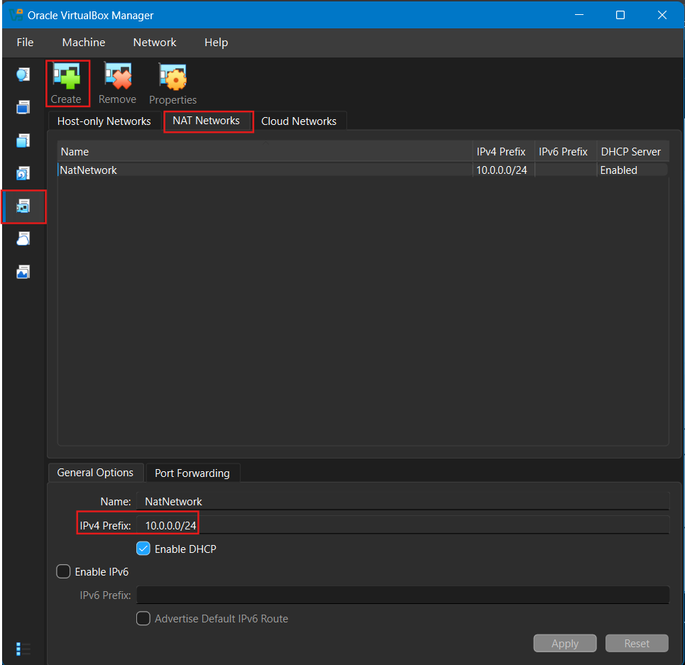
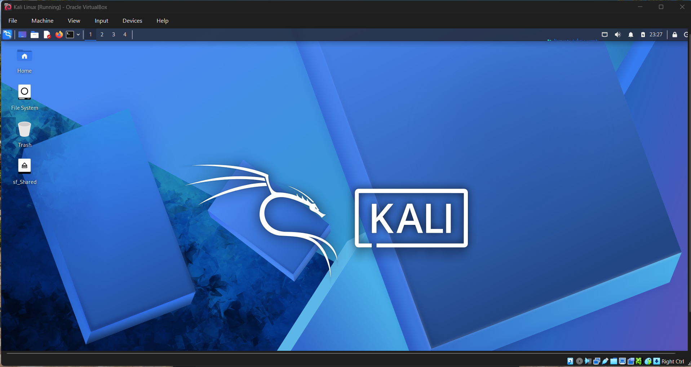
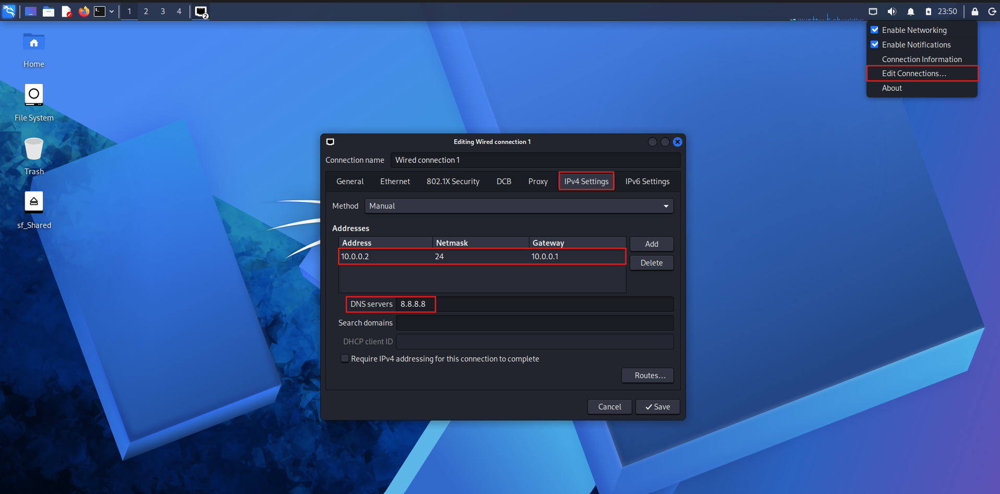

# 🔐 Cybersecurity Lab Setup: Kali Linux on VirtualBox

A step-by-step record of configuring a Kali Linux virtual machine on
Oracle VirtualBox using a dedicated NAT Network and a static IPv4
address.

------------------------------------------------------------------------

## 📌 Project Overview

This project documents the initial setup of a virtual cybersecurity lab
using **Oracle VirtualBox** and **Kali Linux**. The goal is to prepare a
repeatable environment for learning networking, reconnaissance,
vulnerability assessment, and other cybersecurity concepts in a
controlled lab.

The lab uses a VirtualBox **NAT Network** named `NatNetwork`. Kali Linux
is configured with a static IPv4 address so the VM can be identified
consistently during future lab exercises.

> **Note:** The screenshots document the configuration shown below.
> Connectivity tests and snapshot creation should be completed and
> verified separately if they have not already been done.

------------------------------------------------------------------------

## 📸 Lab Setup Screenshots

The screenshots below show the configuration in sequence.

### 1. Create the VirtualBox NAT Network



### 2. Start Kali Linux in VirtualBox



### 3. Configure Kali Linux IPv4 Settings



---

## 🎯 Objectives

-   Create a dedicated NAT Network in VirtualBox.
-   Enable DHCP on the NAT Network for network clients that use
    automatic addressing.
-   Connect the Kali Linux VM to the `NatNetwork`.
-   Configure a static IPv4 address, gateway, and DNS server in Kali
    Linux.
-   Verify local network and internet connectivity.
-   Keep the lab configuration documented for future cybersecurity
    exercises.

------------------------------------------------------------------------

## 🏗️ Lab Architecture

``` text
                 Internet
                    |
             VirtualBox NAT
                    |
        NAT Network: NatNetwork
             10.0.0.0/24
                    |
          +---------+---------+
          |                   |
      Kali Linux          Future lab VMs
      10.0.0.2/24         10.0.0.x/24
          |
      Gateway: 10.0.0.1
      DNS: 8.8.8.8
```

Future virtual machines can be attached to the same NAT Network for
lab-to-lab communication. Use intentionally vulnerable targets only in
an isolated lab and configure their networking carefully.

------------------------------------------------------------------------

## ⚙️ Lab Configuration

  Component                   Configuration
  --------------------------- ---------------------------------------------
  Hypervisor                  Oracle VirtualBox
  Security operating system   Kali Linux
  Virtual network mode        NAT Network
  NAT Network name            `NatNetwork`
  IPv4 network prefix         `10.0.0.0/24`
  DHCP server                 Enabled on the NAT Network
  Kali IPv4 address           `10.0.0.2`
  Prefix length               `/24`
  Subnet mask                 `255.255.255.0`
  Default gateway             `10.0.0.1`
  DNS server                  `8.8.8.8`
  IPv6                        Disabled for this NAT Network configuration

**Networking note:** DHCP is enabled on the VirtualBox NAT Network, but
the Kali connection shown in the screenshots is set to **Manual** and
uses `10.0.0.2`. Ensure the static address is outside the DHCP
allocation range, or reserve/exclude it, to avoid an IP address
conflict.

------------------------------------------------------------------------

## 🪜 Setup Procedure

### Step 1: Create the NAT Network in VirtualBox

1.  Open **Oracle VirtualBox Manager**.
2.  Open the **Network** section and select the **NAT Networks** tab.
3.  Create a NAT Network named `NatNetwork`.
4.  Set the IPv4 prefix to `10.0.0.0/24`.
5.  Keep **Enable DHCP** selected.
6.  Leave IPv6 disabled unless your lab specifically requires it.
7.  Apply the settings.

The resulting network provides NAT connectivity and allows VMs attached
to the same NAT Network to communicate with each other.

### Step 2: Attach Kali Linux to the NAT Network

1.  Shut down the Kali VM before changing its virtual hardware settings.
2.  Open the VM's **Settings → Network**.
3.  Enable Adapter 1.
4.  Set **Attached to** to **NAT Network**.
5.  Select `NatNetwork`.
6.  Save the settings and start Kali Linux.

The adapter must use the NAT Network, not the separate **NAT** mode, if
you want multiple lab VMs on the same virtual network to communicate
directly.

### Step 3: Configure IPv4 in Kali Linux

1.  Open the network menu in the Kali desktop.
2.  Select **Edit Connections**.
3.  Open the active wired connection.
4.  Go to **IPv4 Settings**.
5.  Set the method to **Manual**.
6.  Add the following values:

  Field              Value
  ------------------ ------------
  Address            `10.0.0.2`
  Netmask / prefix   `24`
  Gateway            `10.0.0.1`
  DNS server         `8.8.8.8`

7.  Save the connection.
8.  Disconnect and reconnect the wired connection, or restart networking
    if needed.

If your network interface or connection name differs, use the actual
name shown by your system.

------------------------------------------------------------------------

## 🔎 Verify the Configuration

Run these commands in a Kali terminal after applying the settings.

### 1. Check the IP address

``` bash
ip -4 addr
```

Confirm that the active interface has `10.0.0.2/24`.

### 2. Check the routing table

``` bash
ip route
```

Confirm that the default route uses gateway `10.0.0.1`.

### 3. Check the gateway

``` bash
ping -c 4 10.0.0.1
```

A successful response indicates that the gateway is reachable. If it
fails, check the VirtualBox adapter attachment and IPv4 configuration.

### 4. Check internet connectivity

``` bash
ping -c 4 8.8.8.8
```

If this works but domain names do not resolve, investigate DNS settings.

### 5. Check DNS resolution

``` bash
getent hosts kali.org
```

A returned IP address indicates that name resolution is working. An
alternative is:

``` bash
nslookup kali.org
```

If `nslookup` is not installed, use `getent hosts` or install the
required DNS utility.

### 6. Check the network configuration

``` bash
nmcli connection show
nmcli device status
```

These commands help identify the connection profile and the active
network interface.

------------------------------------------------------------------------

## 🛠️ Troubleshooting

### No internet after setting a static IP

-   Confirm that Adapter 1 is attached to `NatNetwork`.
-   Check the address, prefix, gateway, and DNS values.
-   Verify the default route with `ip route`.
-   Test the gateway first, then an external IP, and then a domain name.
-   Reconnect the NetworkManager connection after saving changes.

### IP address conflict

Because DHCP is enabled on the NAT Network, make sure `10.0.0.2` is not
being assigned to another VM. Keep the static IP outside the DHCP pool
or configure the DHCP pool/reservation appropriately.

### Gateway does not respond

-   Confirm the NAT Network prefix is `10.0.0.0/24`.
-   Confirm the VM is attached to the correct NAT Network.
-   Check that the VM's address is `10.0.0.2/24` and gateway is
    `10.0.0.1`.
-   Review VirtualBox network settings and the Kali connection profile.

### DNS is not resolving

Check the configured DNS server and test IP connectivity separately. A
working ping to `8.8.8.8` with failed domain lookups usually points to a
DNS configuration issue, though ICMP may be blocked on some networks.

------------------------------------------------------------------------

## 💡 What This Lab Setup Helps Practise

-   VirtualBox virtual networking and NAT Network configuration.
-   IPv4 addressing, subnet masks, gateways, and DNS.
-   Linux network troubleshooting with `ip`, `ping`, and `nmcli`.
-   Preparing a repeatable environment for network scanning and security
    testing.
-   Documenting lab configuration before adding more VMs or tools.

------------------------------------------------------------------------

## 🔐 Security and Ethical Use

This environment is for education and authorized security testing only.
Scan or test only systems you own or have explicit permission to assess.
Keep intentionally vulnerable targets isolated from personal and
production networks.

Before experimenting with tools or vulnerable targets, take a clean VM
snapshot so you can return to a known-good state.

------------------------------------------------------------------------

## 🔗 Tools and Resources

-   [Oracle VirtualBox
    Downloads](https://www.virtualbox.org/wiki/Downloads)
-   [Kali Linux --- Official Download
    Page](https://www.kali.org/get-kali/)
-   [Kali Linux Network Configuration
    Documentation](https://www.kali.org/docs/)

------------------------------------------------------------------------

## 👤 Author

**Md. Sibgatur Rahman Efti**

-   GitHub: [@efti74](https://github.com/efti74)
-   LinkedIn: [Md. Sibgatur Rahman
    Efti](https://www.linkedin.com/in/md-sibgatur-rahman-efti-861b67207/)

------------------------------------------------------------------------

## 📌 Project Information

-   **Project:** Cybersecurity Lab Setup
-   **Platform:** Oracle VirtualBox
-   **Virtual Machine:** Kali Linux
-   **Network Mode:** NAT Network
-   **Status:** Initial network configuration documented; run the
    verification commands above to confirm connectivity.

------------------------------------------------------------------------

*Use this README as a living lab log. Update it when you change the IP
plan, add target machines, or verify additional tests.*
